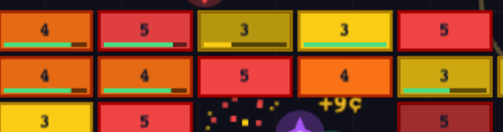
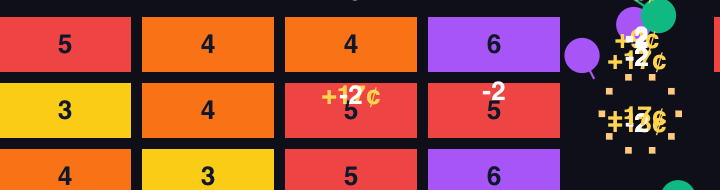

# Batch 4 renderer decision

**Keep Phaser for the Batch 5 simulation extraction.** Canvas2D met the bundle and DPR goals. At 50 balls it missed the 16.7 ms frame budget and was slower than the current build on the same machine. Revisit after Batch 5, when a renderer can consume snapshots and reuse a static brick/text layer. Require a repeatable 50-ball run at DPR 2 on target hardware and visual parity before switching. Production HiDPI remains open in #56.

## Requirements and design

- When the opt-in variant builds, the game path shall exclude Phaser and reduce lazy board JavaScript by more than 90%.
- When the board fits its container at DPR 2, it shall rasterize labels at the displayed physical size and map pointer coordinates to the 800 × 500 logical arena.
- When 50 balls are active, compare browser frame intervals against both the current Phaser build and the 16.7 ms budget. When the document becomes hidden, check save, suspension, and resume behavior.

The normal build lazy-loads Phaser. A separate Vite config substitutes the Canvas component at that same import. Both adapters call the existing fixed step, grid lookup, damage, rewards and refill through the extracted BoardSimulation. Its three effect callbacks cover text, particles and explosion shake. The spike draws tier labels, balls, trails, rings, particles and popups. The production renderer also has arena decoration, ball silhouettes, health bars, camera shake and pooled effects. The source counts below reflect that difference.

## Measurements

Apple M4, macOS 27.2.1, Chrome 144.0.7559.133. Production builds, 1280 × 900 CSS viewport, DPR 2. Each independent page restored the same 50-ball mix cycling through all six types. Spawn angles and brick tiers varied normally. After 1.5 seconds of warm-up, each run collected 360 requestAnimationFrame intervals while bricks broke. Run order was Canvas, Phaser, Phaser, Canvas.

| Measure | Phaser on main (93bdbb5) | Canvas2D spike |
| --- | ---: | ---: |
| Lazy board JS, minified | 1,437 kB | 54 kB (96.3% smaller) |
| Display size in CSS pixels | 880 × 550 | 880 × 550 |
| Backing store in pixels | 800 × 500 | 1760 × 1100 |
| Mean frame interval, two runs | 63.5 / 63.5 ms | 85.0 / 76.2 ms |
| Median frame interval | 66.6 / 66.6 ms | 83.3 / 83.2 ms |
| 95th percentile interval | 83.3 / 83.3 ms | 116.7 / 83.4 ms |
| Renderer-specific source after extraction | 771 lines | 153 lines |

A repeat with the checked-in benchmark on the final adapter measured means of 77.8 ms for Canvas and 67.1 ms for Phaser. At a narrower 640 CSS-pixel viewport and DPR 2, one pointer click on the first brick increased the broken-brick counter from zero to one in each build.

Size sums the game and renderer chunks, excluding the common entry and loader. Source lines include comments and blanks across the Phaser mount, config, scene, renderer, effects and color helper, versus the Canvas component. Both exclude shared simulation, state and physics. Frame intervals measure the whole running app in automated headless Chrome on this host. Neither build reproduced the historical 60 FPS result. Canvas also draws 4.84 times as many backing pixels here, so these numbers compare the proposed user experiences rather than isolating API overhead.

## DPR 2 detail

Device-pixel crops from the same board region in separate live runs show the tier numerals. Phaser enlarges the 800 × 500 buffer. Canvas rasterizes the glyphs at the fitted device size.

| Phaser | Canvas2D |
| --- | --- |
|  |  |

## Visibility

With a synthetic hidden event and the browser clock still running, the Canvas brick counter held steady for 1.2 seconds and advanced after the visible event. Phaser continued advancing under that artificial clock. Both use the existing React visibility hook for saving and idle credit. The lifecycle tests cover five minutes hidden and one-time credit. Automated tab activation on this host kept reporting visible, so native background scheduling remains unverified.

## Reproduce

From separate terminals, build and preview each variant. Use the parent main revision for the historical Phaser baseline or the regular build on this branch to exercise the extracted simulation.

```sh
npm run build
npm run preview -- --port 4281 --strictPort
```

```sh
npx vite build --config vite.canvas.config.ts --outDir dist/canvas
npm run preview -- --outDir dist/canvas --port 4282 --strictPort
```

The optional benchmark uses Playwright and an installed Google Chrome. Install the benchmark dependency outside the game checkout and pass the preview URLs in measurement order.

```sh
bench_tools=$(mktemp -d)
npm install --prefix "$bench_tools" playwright
base=http://localhost:4281/vibe-idle-bricks/
spike=http://localhost:4282/vibe-idle-bricks/
NODE_PATH="$bench_tools/node_modules" node scripts/compare-renderers.cjs "$spike" "$base" "$base" "$spike"
```
